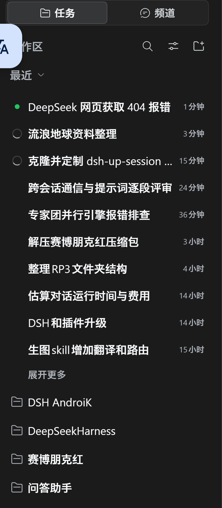
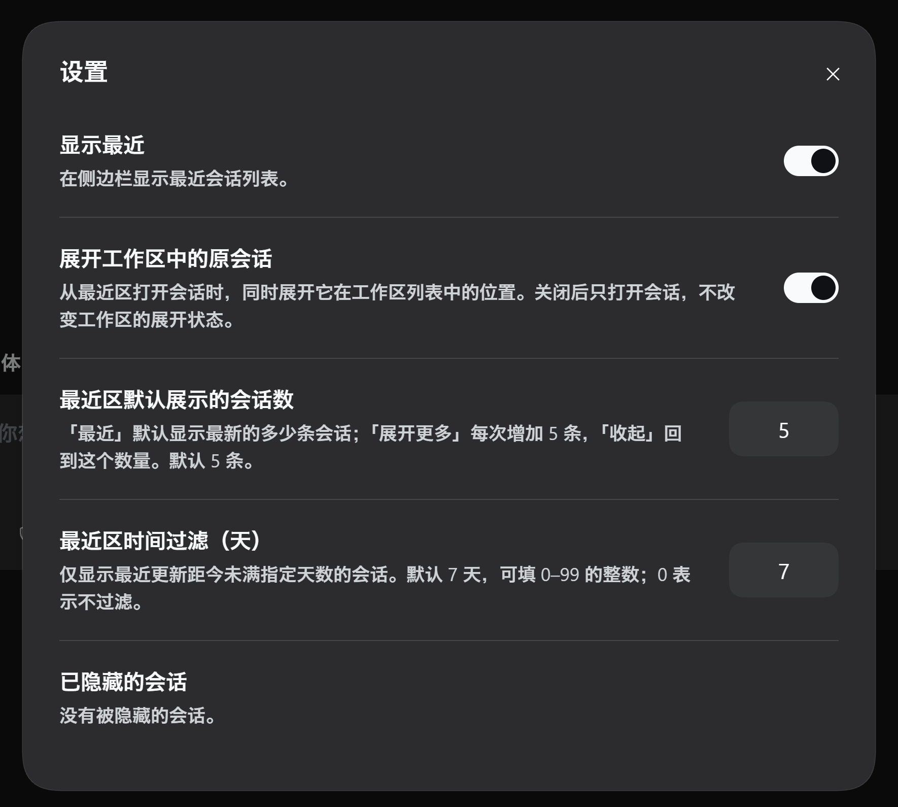

# dsh-recent-sessions

A DeepSeek Harness sidebar plugin: it adds a collapsible **Recent** group at the top of the workspace list, gathering the latest sessions from every workspace into one place.

This repository is a customized fork of [kyrsieger/dsh-up-session](https://github.com/kyrsieger/dsh-up-session): **the Pinned section and its actions were removed; only Recent remains**, and the mount logic was updated for the DSH `0.2.2-rc.2` sidebar structure.



## Installation and compatibility

Requires DSH `>=0.2.2-rc.2`.

- **Desktop (local directory)**: **Plugins** → **Add plugin** and pick this directory, or use `plugin_manager` `install_bundle` with this directory as `target`.
- **Web**: `dsh plugin --profile <profile> add <absolute path to this directory>`.

Enable the plugin on the Plugins page; a **Recent** group appears above the workspaces.

## Recent

- Collects ordinary, unarchived sessions across **all workspaces** that are not hidden from Recent, newest first.
- Shows the latest 5 by default. When more exist, **Show more** adds 5 per click and turns into **Show less** once everything is visible.
- Rows carry the same status marks as the workspace list (running / waiting for you / just finished); idle rows reserve the same leading space.
- Hovering a row opens a session card: full title, owning workspace, working directory, relative time, and current status.
- Hovering shows **Archive** and **Hide from Recent**; right-click opens the host's own session menu (rename, fork, copy Session ID, show in file manager, pin, and so on — all provided by the host).
- Clicking a row opens the session; by default its original position in the workspace list is also revealed, which can be turned off in settings.

## Settings

Open it from the gear in the section header or from **Open settings** on the plugin detail page:



| Setting | Meaning |
|---|---|
| Show Recent | Toggle the whole section |
| Reveal the session in its workspace | Whether opening a row also expands its workspace |
| Sessions shown in Recent | Rest rows, default 5; **Show more** always adds 5 |
| Recent time filter (days) | Only include sessions updated less than N days ago; `0` disables the filter |
| Hidden sessions | See the count and restore all; a new message also brings a session back |

Preferences live in browser localStorage, scoped to the profile's web origin.

## Differences from upstream

| Item | Upstream 1.2.2 | This fork |
|---|---|---|
| Pinned section | Yes | **Removed** |
| Pin / unpin row actions | Yes | **Removed** |
| "Show Pinned" setting | Yes | **Removed** |
| Recent excludes pinned sessions | Yes | **No** (a pin is a host state, not an inclusion rule) |
| Sidebar mount point | `[data-sidebar-list-area]` | Same upstream fix (the host marks the list area explicitly since rc.2, so the scroll-state container cannot cause repeated remounts) |

## Development

```powershell
node --check client.js
node --test tests/recent-time-filter.test.cjs tests/reveal-original.test.cjs tests/sidebar-mount.test.cjs
```

- `client.js` is the browser module; the id registered with `window.__ModuleLoader__.load` must equal `package.json`'s `name`.
- `index.js` only provides the bundle's Host row; `apply()` is empty.
- When changing the supported DSH version, update `engines.dsh` in `package.json` and the line above together.

## License

MIT. Upstream copyright belongs to kyrsieger; this fork's changes are released under the same license.
