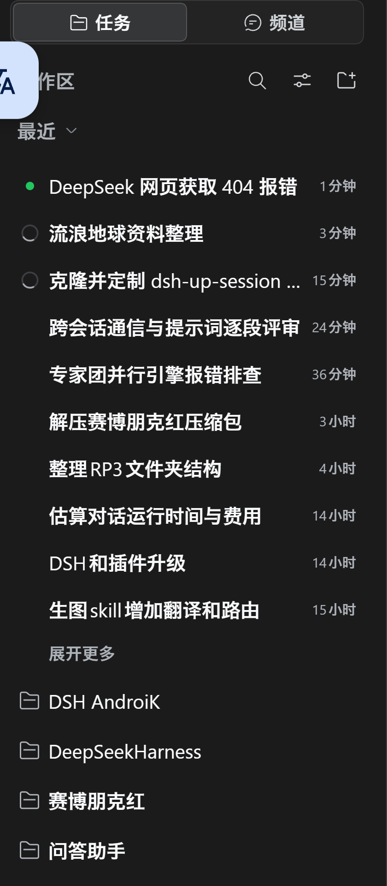
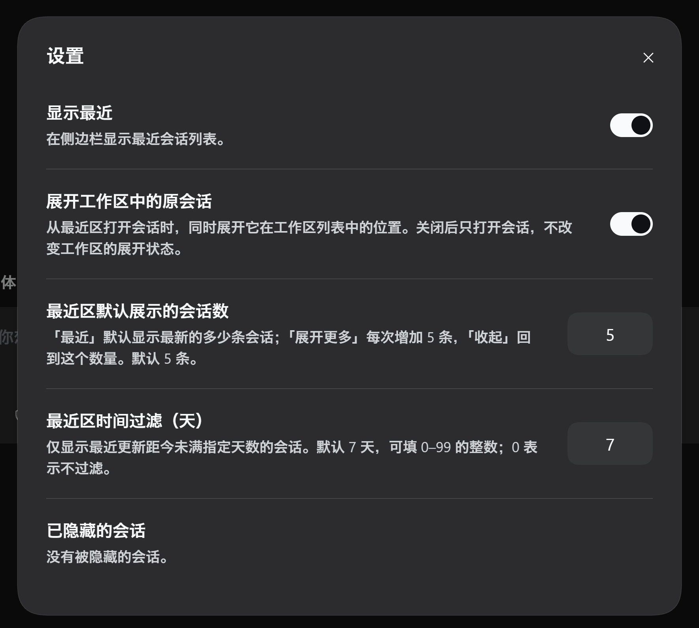

# dsh-recent-sessions

一个 DeepSeek Harness 侧边栏插件：在「工作区」列表顶部插入一个可折叠的「最近」分组，把分散在各个工作区里的最近会话汇总到一处。

本仓库是 [kyrsieger/dsh-up-session](https://github.com/kyrsieger/dsh-up-session) 的定制分支：**去掉了「置顶区」及相关操作，只保留「最近」**，并针对 DSH `0.2.2-rc.2` 的侧栏结构修正了挂载逻辑。



## 安装与兼容

要求 DSH `>=0.2.2-rc.2`。

- **桌面端（本地目录）**：侧边栏「插件」→「添加插件」，选择本目录；或用 `plugin_manager` 的 `install_bundle` 指向本目录。
- **Web 端**：`dsh plugin --profile <profile> add <本目录的绝对路径>`。

安装后在插件页启用即可，侧栏「工作区」上方会出现「最近」。

## 最近区

- 按最近更新时间汇总**所有工作区**中未归档、未被「从最近隐藏」的普通会话。
- 默认显示最新 5 条；超过时底部出现「展开更多」，每点一次增加 5 条。列表一旦超过默认数量，底部右侧同时出现「收起」，随时可回到默认数量；全部显示后只剩「收起」。
- 会话行左侧与工作区列表保持一致的状态标记（进行中 / 等待回应 / 刚完成）；空闲行也预留标记位置。
- 鼠标停留会出现会话悬浮卡片：完整标题、所属工作区、工作目录、相对时间与当前状态。
- 每行悬停出现「归档」与「从最近隐藏」；右键打开宿主自己的会话菜单（重命名、分叉、复制 Session ID、在文件管理器中显示、置顶等，均由宿主提供）。
- 点击一行打开会话；默认同时展开它在工作区列表中的原位置，可在设置中关闭。

## 设置

标题栏悬停出现齿轮，或从插件详情页的「打开设置」进入：



| 设置项 | 说明 |
|---|---|
| 显示最近 | 开关整个最近区 |
| 展开工作区中的原会话 | 从最近区打开会话时是否展开其工作区 |
| 最近区默认展示的会话数 | 默认 5 条，`展开更多` 每次固定加 5 |
| 最近区时间过滤（天） | 只收录最近更新距今未满 N 天的会话；`0` 表示不过滤 |
| 已隐藏的会话 | 查看数量并一键恢复；会话有新消息后也会自动回到最近区 |

设置保存在浏览器 localStorage 中，按 profile 的 Web 源区分。

## 与上游的差异

| 项 | 上游 1.2.2 | 本分支 |
|---|---|---|
| 置顶区 | 有 | **已移除** |
| 置顶 / 取消置顶行操作 | 有 | **已移除** |
| 「显示置顶」设置 | 有 | **已移除** |
| 最近区是否会排除置顶会话 | 会 | **不会**（置顶只是一个宿主状态，不再是最近区的收录条件） |
| 侧栏挂载点 | `[data-sidebar-list-area]` | 同上游修复（rc.2 起宿主显式标记，避免侧栏滚动状态导致反复挂载） |

## 开发

```powershell
node --check client.js
node --test tests/recent-time-filter.test.cjs tests/reveal-original.test.cjs tests/sidebar-mount.test.cjs
```

- `client.js` 是浏览器端模块，`window.__ModuleLoader__.load` 注册的模块 id 必须与 `package.json` 的 `name` 一致。
- `index.js` 只提供 bundle 的 Host 行，`apply()` 为空。
- 修改兼容版本时，同步更新 `package.json` 的 `engines.dsh` 与本文「安装与兼容」。

## 许可证

MIT。上游版权归 kyrsieger；本分支的修改同样以 MIT 发布。
